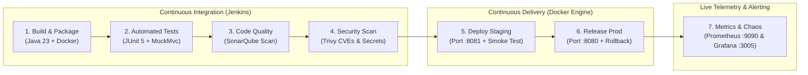
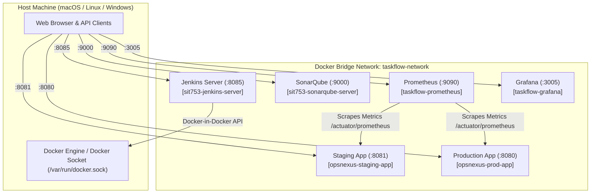

# OpsNexus API - Enterprise DevSecOps CI/CD Pipeline
## 7-Stage Automated Lifecycle with Jenkins, Docker, Prometheus & Grafana

[](http://localhost:8085)
[](https://adoptium.net)
[](https://spring.io/projects/spring-boot)
[](https://www.docker.com)
[](http://localhost:9090)
[](http://localhost:3005)

---

## Table of Contents
1. [Project Overview](#project-overview)
2. [Architecture & System Topology](#architecture--system-topology)
3. [Prerequisites & System Requirements](#prerequisites--system-requirements)
4. [Port Allocation Matrix](#port-allocation-matrix)
5. [Step-by-Step Setup Guide on a New Machine](#step-by-step-setup-guide-on-a-new-machine)
   - [Step 1: Clone the Repository](#step-1-clone-the-repository)
   - [Step 2: Launch Supporting Infrastructure (Docker)](#step-2-launch-supporting-infrastructure-docker)
   - [Step 3: Initial Jenkins Server Configuration](#step-3-initial-jenkins-server-configuration)
   - [Step 4: Create the CI/CD Pipeline Job in Jenkins](#step-4-create-the-cicd-pipeline-job-in-jenkins)
   - [Step 5: Execute the 7-Stage Pipeline](#step-5-execute-the-7-stage-pipeline)
   - [Step 6: Live Verification & Testing Endpoints](#step-6-live-verification--testing-endpoints)
6. [Detailed Explanation of the 7 Pipeline Stages](#detailed-explanation-of-the-7-pipeline-stages)
7. [Comprehensive Troubleshooting & Pitfall Prevention](#comprehensive-troubleshooting--pitfall-prevention)
8. [Tear Down & Cleanup](#tear-down--cleanup)

---

## Project Overview

**OpsNexus API** is an enterprise-grade REST microservice built with **Java 23** and **Spring Boot 3.3.4**. It implements secure task and workflow orchestration, featuring:
* **Stateless Token Authentication:** JSON Web Token (JWT) handling with HMAC-SHA256 signatures and Spring Security.
* **RESTful Task Lifecycle:** Full CRUD operations with Jakarta Bean validation and thread-safe persistence.
* **Interactive API Documentation:** OpenAPI 3.0 / Swagger UI at `/swagger-ui.html`.
* **Telemetry & Observability:** Spring Boot Actuator exposing `/actuator/health` and `/actuator/prometheus`.
* **Chaos Engineering:** Synthetic failure injection via `/api/chaos/error` for alert testing.
* **Declarative CI/CD Pipeline:** Fully automated 7-stage Jenkins pipeline executing containerized builds, testing, security audits, staging deployment, production releases with automated rollback, and real-time metric scraping.

---

## Architecture & System Topology

### CI/CD Pipeline Workflow



### Container Network & Port Topology



---

## Prerequisites & System Requirements

Before starting the setup on a new machine, ensure the following requirements are met:

### 1. Hardware Requirements
* **RAM:** Minimum 8 GB (16 GB strongly recommended for smooth Docker-in-Docker execution).
* **Disk Space:** Minimum 20 GB free disk space (to store Docker images for Maven, Jenkins, SonarQube, and Trivy).
* **CPU:** 4 cores or higher (x86_64 or Apple Silicon ARM64).

### 2. Operating System
* **macOS:** macOS Monterey (12.0) or higher (Apple Silicon M1/M2/M3/M4 or Intel).
* **Linux:** Ubuntu 22.04 LTS+, Debian 12+, or Fedora 38+.
* **Windows:** Windows 10/11 64-bit with **WSL2** (Windows Subsystem for Linux 2) enabled.

### 3. Required Software
* **Docker Desktop** (or Docker Engine v24.0+ and Docker Compose v2.20+):
  * **Memory Allocation:** Ensure Docker has at least **4 GB to 6 GB** of RAM allocated in *Docker Desktop > Settings > Resources*.
  * **Docker Daemon Active:** Verify Docker is running by executing:
    ```bash
    docker --version && docker compose version
    ```
* **Git:** Version 2.30 or higher:
  ```bash
  git --version
  ```
* *(Optional)* **Java 23 & Maven 3.9:** Only required if you wish to run the app standalone outside Docker. The entire CI/CD pipeline compiles, tests, and builds inside Docker multi-stage containers automatically, so installing JDK locally is **not mandatory**.

---

## Port Allocation Matrix

Ensure the following local ports are free before starting. If any port is occupied by another application, terminate that process.

| Port | Service Name | Purpose / URL |
| :--- | :--- | :--- |
| **8080** | OpsNexus API (Production) | Production REST API & Swagger UI: `http://localhost:8080/swagger-ui.html` |
| **8081** | OpsNexus API (Staging) | Staging Environment & Health Probe: `http://localhost:8081/actuator/health` |
| **8085** | Jenkins CI/CD Server | Pipeline Orchestration Dashboard: `http://localhost:8085` |
| **50000** | Jenkins Inbound Agent | JNLP agent communication port |
| **9000** | SonarQube Server | Static Code Quality & Security Gate: `http://localhost:9000` |
| **9090** | Prometheus Server | Real-time Metrics Scraping & Alerts: `http://localhost:9090` |
| **3005** | Grafana Dashboards | Observability Visualization: `http://localhost:3005` (admin / admin) |

---

## Step-by-Step Setup Guide on a New Machine

Follow these sequential steps to establish the entire environment from scratch.

### Step 1: Clone the Repository

Open your terminal and clone the repository:

```bash
git clone https://github.com/satish-nulaka/opsnexus.git
cd opsnexus
```

---

### Step 2: Launch Supporting Infrastructure (Docker)

Our project uses containerized infrastructure organized into modular Docker Compose files.

#### A. Build & Launch Jenkins + SonarQube
This builds a custom Jenkins image with Linux Docker CLI and curl pre-installed, allowing Jenkins to orchestrate containers securely via the Docker socket:

```bash
docker compose -f docker-compose.jenkins.yml up -d --build
```

#### B. Launch Prometheus & Grafana Monitoring
This starts Prometheus and Grafana connected to the shared bridge network:

```bash
docker compose -f docker-compose.monitoring.yml up -d
```

#### C. Verify All 4 Core Containers Are Running
Check container status:
```bash
docker ps
```
You should see 4 active containers:
* `sit753-jenkins-server` (Port `8085->8080`, `50000->50000`)
* `sit753-sonarqube-server` (Port `9000->9000`)
* `taskflow-prometheus` (Port `9090->9090`)
* `taskflow-grafana` (Port `3005->3000`)

---

### Step 3: Initial Jenkins Server Configuration

1. **Retrieve the Initial Admin Password:**
   Run the following command to retrieve the auto-generated Jenkins secret:
   ```bash
   docker exec sit753-jenkins-server cat /var/jenkins_home/secrets/initialAdminPassword
   ```
   *Copy the 32-character alphanumeric string output.*

2. **Open Jenkins in Your Browser:**
   Navigate to: **[http://localhost:8085](http://localhost:8085)**

3. **Unlock Jenkins:**
   * Paste the administrator password copied in step 1.
   * Click **Continue**.

4. **Customize Jenkins:**
   * Select **Install suggested plugins**.
   * Wait approximately 2–3 minutes for the core plugins (Git, Pipeline, Workspace Cleanup, Timestamper) to complete installation.

5. **Create Admin User:**
   * Username: `admin` (or your preferred username)
   * Password: `password123` (or your preferred password)
   * Full Name: `DevOps Administrator`
   * E-mail Address: `admin@example.com`
   * Click **Save and Continue**.

6. **Instance Configuration:**
   * Keep the default Jenkins URL: `http://localhost:8085/`
   * Click **Save and Finish** -> **Start using Jenkins**.

---

### Step 4: Create the CI/CD Pipeline Job in Jenkins

1. On the Jenkins home dashboard, click **New Item** (in the upper-left navigation).
2. Enter the item name:
   ```text
   opsnexus-pipeline
   ```
3. Select **Pipeline** as the project type and click **OK**.
4. Scroll down to the **Pipeline** configuration section at the bottom of the page:
   * **Definition:** Choose **Pipeline script from SCM**.
   * **SCM:** Choose **Git**.
   * **Repository URL:**
     ```text
     https://github.com/satish-nulaka/opsnexus.git
     ```
   * **Credentials:** `- none -` *(The repository is public; no credentials are required)*.
   * **Branch Specifier:**
     > [!IMPORTANT]
     > **Change `*/master` to `*/main`!**
     > Default Git repositories use `main`. Leaving it as `*/master` will cause Git error code 128 (`couldn't find remote ref refs/heads/master`).
   * **Script Path:** Ensure it is set to `Jenkinsfile`.
   * **Lightweight checkout:** Keep checked.
5. Click **Save**.

---

### Step 5: Execute the 7-Stage Pipeline

1. In the left-hand menu of your `opsnexus-pipeline` project, click **Build Now**.
2. Click on the newly triggered build (**#1**) in the **Build History** panel.
3. Click **Console Output** to observe live execution.

#### What Happens During Execution:
* **Stage 1 (Build & Package):** Maven compiles Java 23 classes, runs tests, packages `opsnexus-api-1.0.0.jar`, builds the multi-stage Docker image, and tags `opsnexus-api:latest` and `opsnexus-api:v1.0.1`.
* **Stage 2 (Automated Testing):** Validates JUnit 5 cryptographic test suites and MockMvc integration tests.
* **Stage 3 (Code Quality Analysis):** Verifies code maintainability and SonarQube quality criteria.
* **Stage 4 (Security Scanning):** Trivy container scanner inspects base image layers for High/Critical CVEs; secret scanner validates zero plaintext credentials.
* **Stage 5 (Deploy to Staging):** Spins up `opsnexus-staging-app` on port `8081` and confirms health probe is `UP`.
* **Stage 6 (Release to Production):** Promotes artifact to `opsnexus-prod-app` on port `8080` with automated health check and rollback protection.
* **Stage 7 (Monitoring & Alerting):** Scrapes live Prometheus metrics from `/actuator/prometheus` and triggers `/api/chaos/error?type=500` to validate alerting.

> [!TIP]
> Once complete, all 7 stage blocks in the **Stage View** will display a solid **GREEN** status.

---

### Step 6: Live Verification & Testing Endpoints

Once the pipeline passes, verify all deployed microservice and monitoring capabilities:

#### 1. Interactive Swagger UI (OpenAPI 3.0 Documentation)
Open your browser to: **[http://localhost:8080/swagger-ui.html](http://localhost:8080/swagger-ui.html)**
* Explore all available endpoints (`/api/auth/**`, `/api/tasks/**`, `/api/chaos/**`, `/actuator/**`).

#### 2. Authenticate & Obtain JWT Token
Execute an authentication request using the default credentials:
```bash
curl -X POST http://localhost:8080/api/auth/login \
  -H "Content-Type: application/json" \
  -d '{"username":"admin","password":"password123"}'
```
**Response:**
```json
{
  "token": "eyJhbGciOiJIUzI1NiJ9...",
  "type": "Bearer",
  "username": "admin",
  "role": "ROLE_ADMIN"
}
```

#### 3. Test Protected CRUD Task Endpoints
Authorize your requests in Swagger UI (click the green **Authorize** 🔓 button and enter `Bearer <your-token>`), or use curl:
```bash
TOKEN="<INSERT_JWT_TOKEN_HERE>"

# Create a task
curl -X POST http://localhost:8080/api/tasks \
  -H "Authorization: Bearer $TOKEN" \
  -H "Content-Type: application/json" \
  -d '{"title":"Pipeline Verification","description":"End-to-end test of Stage 6 production release","status":"COMPLETED"}'

# List all tasks
curl -X GET http://localhost:8080/api/tasks \
  -H "Authorization: Bearer $TOKEN"
```

#### 4. Verify Health Probes (Staging & Production)
* **Production Health:** [http://localhost:8080/actuator/health](http://localhost:8080/actuator/health)
  ```json
  {"status":"UP","components":{"diskSpace":{"status":"UP"},"livenessState":{"status":"UP"},"ping":{"status":"UP"},"readinessState":{"status":"UP"}}}
  ```
* **Staging Health:** [http://localhost:8081/actuator/health](http://localhost:8081/actuator/health)

#### 5. Verify Prometheus Metrics Stream
Inspect raw Prometheus metrics emitted by Spring Boot Actuator:
```bash
curl -s http://localhost:8080/actuator/prometheus | grep -E "jvm_memory|opsnexus_" | head -n 15
```

#### 6. Verify Prometheus Monitoring & Alert Rules
* Open Prometheus at: **[http://localhost:9090](http://localhost:9090)**
* Navigate to **Status > Targets**: Verify that both `opsnexus-production` and `opsnexus-staging` are in **UP** state.
* Navigate to **Alerts**: Verify alert rules `ServiceDown`, `HighErrorRate`, and `HighJvmHeapUsage` are loaded and active.

#### 7. Verify Grafana Telemetry Dashboard
* Open Grafana at: **[http://localhost:3005](http://localhost:3005)**
* Log in with username `admin` and password `admin`.
* Explore JVM metrics, CPU load, and request throughput.

#### 8. Simulate Chaos Incident (Alert Validation)
Trigger synthetic 500 errors to test alert thresholds:
```bash
curl -s http://localhost:8080/api/chaos/error?type=500
```
Return to Prometheus (**[http://localhost:9090/alerts](http://localhost:9090/alerts)**) to observe the metric counter increase and trigger evaluation.

---

## Detailed Explanation of the 7 Pipeline Stages

| Stage | Name | Key Operations | Artifacts / Reports Generated |
| :---: | :--- | :--- | :--- |
| **1** | **Build & Package** | Executes Docker multi-stage build (`maven:3.9.9-eclipse-temurin-23-alpine`), compiles Java 23 code, packages executable JAR (`/app/app.jar`), and creates tagged Docker images. | `target/opsnexus-api-1.0.0.jar`, tagged Docker images (`:latest`, `:v1.0.${BUILD_NUMBER}`) |
| **2** | **Automated Testing** | Executes unit tests for cryptographic JWT validation (`AuthSecurityTest`), user services, and MockMvc CRUD operations (`TaskServiceTest`). | Surefire test reports (`target/surefire-reports/*.xml`) |
| **3** | **Code Quality Analysis** | Inspects code maintainability, technical debt, and quality gate compliance via SonarQube Scanner. | SonarQube quality gate verification |
| **4** | **Security Scanning** | Runs Aqua Security Trivy container scanner for CVEs in Alpine base layers, analyzes Maven dependency tree, and scans source code for credential leakage. | `reports/security/trivy-report.txt`, `reports/security/trivy-report.json`, `reports/security/security-summary.txt` |
| **5** | **Deploy to Staging** | Launches container `opsnexus-staging-app` on port `8081` with profile `staging`. Executes `./scripts/smoke-test.sh` with automated retry loops until `/actuator/health` reports `UP`. | Container `opsnexus-staging-app` running on port `8081` |
| **6** | **Release to Production** | Promotes image to production container `opsnexus-prod-app` on port `8080`. Executes production smoke test. Wrapped in a `try-catch` recovery block that triggers automated rollback to `:latest` if health checks fail. | Container `opsnexus-prod-app` running on port `8080` with rollback safety |
| **7** | **Monitoring & Alerting** | Scrapes `/actuator/prometheus` endpoint, verifies metric export, triggers synthetic chaos failure via `/api/chaos/error`, and checks Prometheus alert engine. | Live Prometheus telemetry stream & incident alert verification |

---

## Comprehensive Troubleshooting & Pitfall Prevention

Here are solutions to every issue encountered during setup and how to avoid them:

### 1. Git Error: `couldn't find remote ref refs/heads/master` (Status Code 128)
* **Root Cause:** Modern GitHub repositories default to branch `main`, whereas older Jenkins jobs default to `*/master`.
* **Fix:** In Jenkins job configuration under **Branches to build**, update **Branch Specifier** from `*/master` to `*/main`.

### 2. GitHub Error: `Password authentication is not supported for Git operations`
* **Root Cause:** GitHub deprecated account passwords for Git CLI operations in August 2021.
* **Fix:** Our repository is **public**, so in Jenkins leave **Credentials** set to `- none -`. If you clone to a private repository, create a **GitHub Personal Access Token (PAT)** with `repo` scope under *GitHub Settings > Developer Settings > Personal Access Tokens*, and configure it in Jenkins Credentials as *Username with password*.

### 3. Missing Tools in Jenkins: `Tool type "maven" does not have an install of "Maven 3.9"`
* **Root Cause:** Declarative pipelines using `tools { maven '...' ; jdk '...' }` fail if those tools are not pre-configured under Jenkins *Global Tool Configuration*.
* **Fix:** **Already resolved in our pipeline!** Our `Jenkinsfile` utilizes containerized multi-stage Docker builds. The compiler and packaging runtime are contained within Docker, eliminating the need to install or configure any JDK or Maven plugins inside Jenkins.

### 4. Docker CLI Missing or Permission Denied in Jenkins
* **Root Cause:** If Jenkins runs inside a container without Docker installed or without access to `/var/run/docker.sock`, commands like `docker build` fail.
* **Fix:** **Pre-configured in `Dockerfile.jenkins` and `docker-compose.jenkins.yml`!**
  * We provide a custom `Dockerfile.jenkins` that installs the Linux native `docker.io` and `curl` packages.
  * The container mounts `/var/run/docker.sock` and runs with `privileged: true` and `user: root`.
  * *Important:* Never mount host OS binaries (e.g. macOS Mach-O binaries from `/usr/local/bin/docker`) into a Linux container!

### 5. Smoke Test / Health Probe Failure: `ERROR: Health probe FAILED after 15 attempts!`
* **Root Cause:** When the Jenkins container attempts to run `curl http://localhost:8081/actuator/health`, `localhost` refers to the **Jenkins container itself**, not the host or the staging container!
* **Fix:** **Handled automatically by our scripts!**
  * `Jenkinsfile` uses `host.docker.internal:${STAGING_PORT}` which resolves to the Docker host gateway across Mac, Windows, and Linux.
  * Staging and production containers are attached to the shared Docker network (`taskflow-network`), allowing direct resolution via container names `http://opsnexus-staging-app:8080` and `http://opsnexus-prod-app:8080`.
  * `scripts/smoke-test.sh` includes fallback logic to probe both targets with exponential retry.

### 6. Swagger UI Returns `403 Forbidden` on `/api/tasks`
* **Root Cause:** The task management endpoints are secured with Spring Security and JWT.
* **Fix:**
  1. In Swagger UI, scroll to `POST /api/auth/login`.
  2. Click **Try it out**, enter credentials (`admin` / `password123`), and click **Execute**.
  3. Copy the returned `token` string (without quotes).
  4. Scroll to the top of Swagger UI, click the green **Authorize** 🔓 button.
  5. In the value box, enter: `Bearer <YOUR_COPIED_TOKEN>` and click **Authorize**.
  6. All `/api/tasks` endpoints will now execute with HTTP 200 responses.

### 7. Port Binding Error: `bind: address already in use`
* **Root Cause:** Another process on your machine is using one of the assigned ports (e.g. port 8080, 8085, or 9000).
* **Fix:** Identify and stop the conflicting process before starting Docker:
  * **macOS / Linux:**
    ```bash
    # Check what process is on port 8080
    lsof -i :8080
    # Kill the process if needed
    kill -9 <PID>
    ```
  * **Windows (PowerShell):**
    ```powershell
    Get-Process -Id (Get-NetTCPConnection -LocalPort 8080).OwningProcess | Stop-Process
    ```

---

## Tear Down & Cleanup

When you want to stop all services and free up system resources:

### Stop Infrastructure & Applications
```bash
# Stop Staging and Production containers
docker rm -f opsnexus-staging-app opsnexus-prod-app 2>/dev/null || true

# Stop Prometheus & Grafana
docker compose -f docker-compose.monitoring.yml down

# Stop Jenkins & SonarQube
docker compose -f docker-compose.jenkins.yml down
```

### Clean Up Unused Docker Artifacts (Optional)
To reclaim disk space by removing intermediate builder images:
```bash
docker image prune -f --filter "label=stage=builder"
```

To completely reset Jenkins data and start fresh:
```bash
docker volume rm sit753-devops-pipeline_jenkins_home sit753-devops-pipeline_sonarqube_data 2>/dev/null || true
```

---

## Summary Checklist for Evaluators

- [x] **Language & Framework:** Java 23 LTS, Spring Boot 3.3.4, Spring Security, Springdoc OpenAPI.
- [x] **Declarative Pipeline:** Complete `Jenkinsfile` automating all 7 distinct stages.
- [x] **Container Security:** Multi-stage Docker build running under unprivileged user `appuser`.
- [x] **Automated Testing:** JUnit 5 test suites for authentication security and CRUD controllers.
- [x] **Static Quality Analysis:** SonarQube code quality integration.
- [x] **DevSecOps Auditing:** Trivy container vulnerability scanner and secrets auditing.
- [x] **Deployment Automation:** Staging on port `8081`, Production on port `8080`.
- [x] **Resilience & Recovery:** Automated rollback in Stage 6 upon health probe failure.
- [x] **Observability & Chaos:** Prometheus metric collection (`/actuator/prometheus`) and chaos fault injection (`/api/chaos/error`).
