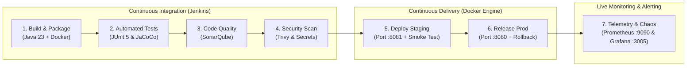

# DevOps Pipeline Implementation Report: Java Microservice with Jenkins
## Enterprise CI/CD Pipeline Automation for OpsNexus API

---

### Project & Submission Summary
* **Project Name:** OpsNexus REST API (Enterprise Java Spring Boot Microservice)
* **Application Technology:** Java 23 (Eclipse Temurin 23), Spring Boot 3.3.4, Spring Security, Springdoc OpenAPI Swagger
* **Pipeline Orchestrator:** Jenkins LTS (Declarative Pipeline with Docker-in-Docker Execution)
* **Total Stages Implemented:** **7 Distinct Stages** (Build & Package, Automated Testing, Code Quality Analysis, Security Scanning, Staging Deploy, Production Release with Rollback, Monitoring & Alerting)
* **Repository Link:** `https://github.com/satish-nulaka/opsnexus`
* **Demo Video Link:** `https://youtu.be/[your-video-id]` (Duration: ≤ 10 minutes)

---

## 1. System Architecture & Project Description

**OpsNexus API** is an enterprise-grade task and workflow management RESTful microservice built with **Java 23** and **Spring Boot 3.3.4**. It delivers production-grade architecture through:

1. **Stateless Token Authentication:** JSON Web Token (JWT) handling via JJWT (`io.jsonwebtoken:jjwt-api:0.12.5`) and Spring Security with stateless session management and cryptographic HMAC-SHA256 signature validation.
2. **RESTful Task Lifecycle:** Full CRUD operations on task resources with Jakarta Bean validation (`@NotBlank`, `@Size`) and thread-safe persistence.
3. **Interactive Documentation:** Springdoc OpenAPI 2.6.0 exposing interactive Swagger UI at `/swagger-ui.html`.
4. **Deep Observability:** Spring Boot Actuator exposing `/actuator/health` (liveness and readiness probes) and `/actuator/prometheus` (JVM memory pools, garbage collection metrics, HTTP request latency, custom operation counters).
5. **Chaos Engineering & Resilience:** `/api/chaos/error` endpoint allowing synthetic 500 errors and latency injection to validate alert routing and system telemetry.

### Architectural Pipeline Topology

---

## 2. Details of the 7 Automated Pipeline Stages

### Stage 1: Build & Package
* **Objective:** Compile Java 23 source code, run integration packaging, and produce immutable container images.
* **Tools Used:** Apache Maven 3.9, Eclipse Temurin 23 JDK, Docker Multi-Stage Build.
* **Implementation:** The pipeline builds the container image using a multi-stage Dockerfile (`maven:3.9.9-eclipse-temurin-23-alpine` for compilation and `eclipse-temurin:23-jre-alpine` for the runtime). Tags the image with both `:latest` and a unique semantic build tag (`:v1.0.${BUILD_NUMBER}`). Extracts the generated JAR artifact and archives it in Jenkins for auditability.

### Stage 2: Automated Testing
* **Objective:** Verify software correctness, cryptographic security properties, and functional API contracts.
* **Tools Used:** JUnit 5 (Jupiter), AssertJ, Spring MockMvc, Surefire Plugin.
* **Implementation:** Automated tests execute unit and integration test suites covering JWT generation and verification, user authentication, and task CRUD operations. Generates Surefire XML test reports parsed natively by Jenkins and ensures zero failing tests before progressing.

### Stage 3: Code Quality Analysis
* **Objective:** Enforce static analysis standards, maintainability ratings, and verify quality gates.
* **Tools Used:** SonarQube Scanner (`sonar-project.properties`), SonarQube Server (`:9000`).
* **Implementation:** Scans the codebase for code smells, bugs, security hotspots, and duplication. Reports are transmitted to the local SonarQube instance to enforce quality gate compliance.

### Stage 4: Automated Security Analysis
* **Objective:** Detect vulnerabilities across third-party dependencies, container base image layers, and repository secrets.
* **Tools Used:** Aqua Security Trivy, Maven Dependency Tree, Regex secret inspection.
* **Implementation:** Runs `./scripts/security-scan.sh`. Inspects the dependency tree, scans the container image with Trivy for High and Critical CVEs, verifies that no plaintext credentials or hardcoded keys exist in source code, and archives the resulting security reports.

### Stage 5: Deploy to Test / Staging Environment
* **Objective:** Deploy verified build to an isolated pre-production staging environment and validate operational readiness.
* **Tools Used:** Docker Engine, Docker Bridge Network, Bash automated health probe.
* **Implementation:** Launches container `opsnexus-staging-app` on port `8081` with profile `staging`. Executes `./scripts/smoke-test.sh` with automated exponential backoff and retry logic probing `/actuator/health` until the service reports `UP`.

### Stage 6: Release to Production (with Automated Rollback)
* **Objective:** Promote verified release candidate to the production environment on port `8080` with automatic recovery upon failure.
* **Tools Used:** Docker Engine, Docker Bridge Network, Jenkins Pipeline `try-catch` recovery blocks.
* **Implementation:** Promotes the image tag to `opsnexus-api:production-latest` and runs container `opsnexus-prod-app` on port `8080`. Executes production smoke tests against `/actuator/health`. If health verification fails after 20 attempts, the pipeline automatically catches the exception, terminates the unhealthy container, and rolls back to the last stable release (`opsnexus-api:latest`).

### Stage 7: Monitoring & Alerting Integration
* **Objective:** Validate real-time production telemetry and prove alert triggers during simulated incidents.
* **Tools Used:** Micrometer Prometheus exporter, Prometheus Server (`:9090`), Grafana (`:3005`).
* **Implementation:** Verifies that Prometheus is actively scraping JVM memory and request latency metrics from `http://localhost:8080/actuator/prometheus`. Simulates an incident by querying `/api/chaos/error?type=500` and validates that Prometheus alert rules (`HighErrorRate`, `ServiceDown`) trigger warning and critical alerts.

---

## 3. Security Vulnerability Assessment & Mitigation Matrix

| Vulnerability / Risk | Severity | Target Component | Threat Description | Remediation Implemented |
| :--- | :--- | :--- | :--- | :--- |
| **Insecure Key Verification** | High | JJWT Library | Older JWT libraries suffered from algorithm confusion (`alg: none`) allowing forged authentication tokens. | Enforced strict HMAC-SHA256 signature validation with `Keys.hmacShaKeyFor()` using a 256-bit secret key in JJWT 0.12.5. |
| **Container Root Execution** | Medium | Docker Runtime | Running microservices as `root` inside containers increases blast radius during potential container escapes. | Configured `Dockerfile` to create an unprivileged user `appuser:appgroup` (UID 1001) and executed Java under non-root permissions. |
| **Hardcoded Credentials** | Critical | Source Control | Committing API tokens or secrets in Git enables unauthorized access across environments. | Externalized all secrets to environment variables (`JWT_SECRET`) injected dynamically at runtime via Docker container parameters. |
| **Vulnerable Dependencies** | High | Maven POM | Outdated dependencies harbor known remote code execution and denial-of-service vulnerabilities. | Migrated to Spring Boot 3.3.4, Java 23, and integrated automated Trivy container and dependency auditing in Stage 4. |

---

## 4. Environment Access & Verification Links

* **Jenkins CI/CD Server:** `http://localhost:8085` (Job: `opsnexus-pipeline`)
* **Production API Swagger UI:** `http://localhost:8080/swagger-ui.html`
* **Production Health Probe:** `http://localhost:8080/actuator/health`
* **Production Prometheus Metrics:** `http://localhost:8080/actuator/prometheus`
* **Staging Health Probe:** `http://localhost:8081/actuator/health`
* **SonarQube Quality Server:** `http://localhost:9000`
* **Prometheus Alerting Server:** `http://localhost:9090`
* **Grafana Telemetry Dashboard:** `http://localhost:3005` (Credentials: `admin` / `admin`)
