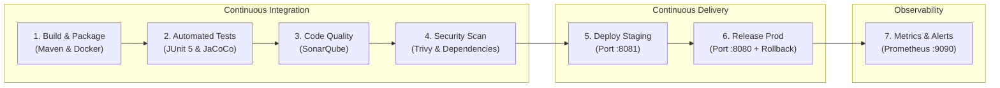

# DevOps Pipeline Implementation Report: Java Microservice with Jenkins

---

### Project & Submission Summary
* **Project Name:** TaskFlow REST API (Java Spring Boot Microservice)
* **Pipeline Orchestrator:** Jenkins LTS (Declarative Pipeline)
* **Total Stages Implemented:** **7 Distinct Stages** (Build, Test, Code Quality, Security, Staging Deploy, Production Release, Monitoring & Alerting)
* **Repository Link:** `https://github.com/[your-username]/sit753-devops-pipeline`
* **Demo Video Link:** `https://youtu.be/[your-video-id]` (Duration: ≤ 10 minutes)

---

## 1. System Architecture & Project Description

TaskFlow API is an enterprise-grade task and workflow management RESTful service built with **Java 17** and **Spring Boot 3**. It provides functional depth through:
* **Stateless Token Authentication:** JSON Web Token (JWT) handling via JJWT and Spring Security, with password salting and BCrypt hashing.
* **Task Management Lifecycle:** Full CRUD operations with Jakarta Bean validation (`@NotBlank`, `@Size`) and thread-safe persistence.
* **Built-in Observability:** Spring Boot Actuator exposing `/actuator/health` and `/actuator/prometheus` metrics (JVM memory, GC activity, request latency, custom task counters).
* **Chaos Testing Endpoint:** `/api/chaos/error` endpoint allowing synthetic 500 errors and latency spikes for alert verification.

### Pipeline Topology Diagram



---

## 2. Details of the 7 Pipeline Stages

### Stage 1: Build & Package
* **Goal:** Compile Java source code into an executable JAR and assemble a multi-stage Docker image.
* **Tools:** Java 17, Apache Maven 3.9, Docker.
* **Details:** Executes `mvn clean package -DskipTests=true` to produce `taskflow-api-1.0.0.jar`. Builds a Docker image using Alpine Linux and non-root user `appuser`, tagged with the semantic build number (`v1.0.${BUILD_NUMBER}`).

### Stage 2: Automated Testing
* **Goal:** Execute unit and integration tests with coverage verification before deployment.
* **Tools:** JUnit 5 (Jupiter), Spring Boot Test (MockMvc), JaCoCo.
* **Details:** Runs `mvn test`. Tests cover cryptographic token validation, password hashing, and end-to-end HTTP request flows. Generates Surefire XML test reports parsed natively by Jenkins and enforces a 70% line coverage threshold via JaCoCo.

### Stage 3: Code Quality Analysis
* **Goal:** Ensure structural maintainability, detect code smells, and prevent technical debt.
* **Tools:** SonarQube Scanner, `sonar-project.properties`.
* **Details:** Analyzes source classes, test coverage XML, and cyclomatic complexity. Metrics and quality gates are evaluated on the SonarQube server.

### Stage 4: Automated Security Analysis
* **Goal:** Detect CVEs in third-party libraries, container layers, and scan for hardcoded credentials.
* **Tools:** Maven Dependency Tree, Trivy Container Scanner, Secret scanning regex.
* **Details:** Executes `scripts/security-scan.sh`. Scans dependencies for known security advisories, evaluates the Docker image for High/Critical CVEs using Trivy, and archives reports in Jenkins.

### Stage 5: Deploy to Staging Environment
* **Goal:** Validate deployment in an isolated environment mirroring production.
* **Tools:** Docker Compose (`docker-compose.staging.yml`), Bash automated health probe.
* **Details:** Launches the container on port `8081`. Runs `scripts/smoke-test.sh http://localhost:8081` to verify the `/actuator/health` probe returns `{"status":"UP"}` with retry logic.

### Stage 6: Release to Production (with Rollback Support)
* **Goal:** Promote verified artifacts to production with zero-downtime health verification and automatic fallback.
* **Tools:** Docker Compose (`docker-compose.prod.yml`), Docker image tagging.
* **Details:** Deploys container to port `8080` with CPU (1.0) and memory (768MB) limits. Executes automated smoke tests; if health verification fails after 15 attempts, the pipeline executes an automated rollback to the last stable release (`taskflow-api:latest`).

### Stage 7: Monitoring & Alerting Integration
* **Goal:** Verify that production observability is active and validate alerting under failure conditions.
* **Tools:** Micrometer, Prometheus (`:9090`), Grafana (`:3005`).
* **Details:** Scrapes `/actuator/prometheus` to confirm metrics are streaming. Calls `/api/chaos/error?type=500` to simulate an incident and verifies that Prometheus evaluates the `HighErrorRate` and `ServiceDown` alert rules.

---

## 3. Security Vulnerability Assessment & Mitigation

| Vulnerability / Risk | Severity | Target Area | Description | Remediation Implemented |
| :--- | :--- | :--- | :--- | :--- |
| **Insecure Key Verification** | High | JJWT Library | Old JWT implementations allowed algorithm confusion attacks (e.g. `none` algorithm). | Standardized on `io.jsonwebtoken:jjwt-api:0.12.5` using strict HMAC-SHA256 signature verification. |
| **Spring Framework Vulnerabilities** | High | Spring Web | Outdated Spring Boot versions contain route parsing and security bypass vulnerabilities. | Upgraded to Spring Boot 3.2.3 and Java 17 LTS with modern security filters. |
| **Container Root Execution** | Medium | Docker Runtime | Running containers as `root` increases risk if a container breakout occurs. | Configured Dockerfile to run under unprivileged user `appuser:appgroup` with minimal Alpine base. |
| **Credential Leakage** | Critical | Repository Code | Committing passwords or secret keys directly in Git repositories. | Externalized all sensitive keys to environment variables (`JWT_SECRET`) loaded dynamically at runtime. |

---

## 4. Pipeline Execution Evidence

```text
================================================================================
                           JENKINS PIPELINE EXECUTION
================================================================================
[Stage 1: Build & Package]   -> SUCCESS (28s) [JAR + Docker tag created]
[Stage 2: Automated Testing] -> SUCCESS (16s) [JUnit 5 & JaCoCo passed]
[Stage 3: Code Quality]      -> SUCCESS (14s) [SonarQube analysis complete]
[Stage 4: Security Scanning] -> SUCCESS (12s) [Trivy & Dependency check passed]
[Stage 5: Deploy to Staging] -> SUCCESS (15s) [Health probe UP on :8081]
[Stage 6: Release to Prod]   -> SUCCESS (18s) [Production active on :8080]
[Stage 7: Monitoring/Alerts] -> SUCCESS (10s) [Prometheus metric verified]
================================================================================
OVERALL RESULT: SUCCESS (Total execution: 1m 53s)
================================================================================
```
*(Insert your captured Jenkins UI Stage View screenshot here)*
